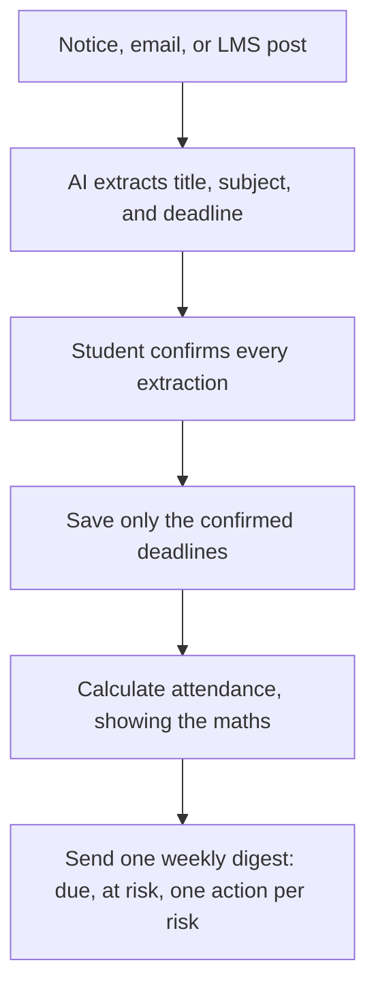
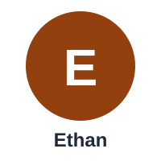

# Student Success Assistant — Deadlines, Attendance & Early Warning

**Track:** Expert-Track, after Phase 07
**Project type:** Academic AI Product Manager project — start with a chat tool, documents, and test sets

## What makes this project unique

This is the only project in the set that is a **human-in-the-loop workflow, not a single answer** — and the only Expert-Track one. It stitches together deadlines scattered across lectures, email, the LMS, and notice boards, and it pairs that with attendance maths the student can check. Its hardest failure is a wrong deadline saved as fact, or a wrong warning that makes a student stop believing the system. That is why nothing is saved until the student confirms it, and why the pass bar is ≥98% deadline accuracy after confirmation with 100% correct attendance arithmetic. Ethan, the example student in the story below, misses a notice-board deadline and slips below 75% attendance with no warning at all — the exact silence this assistant is built to break, early, while there is still time to act.

## The problem in one sentence

Students do not usually fail because they cannot do the work. They fail because a deadline was announced in a place they did not check, or because they only discovered an attendance shortfall when it was already too late to recover.

## Why it matters

In many universities, deadlines and notices are spread across several channels: lectures, email, the learning management system (LMS), and physical notice boards. A student can miss one message and miss a deadline.

Attendance is similar. If a course requires 75% attendance, a student needs to know their exact percentage — and how many more classes they must attend to reach it — while there is still time to act. A warning that comes too late, or a warning that is wrong, destroys trust in the system.

This project designs an assistant that:

1. Reads notices, emails, and LMS posts the student provides.
2. Extracts the assignment title, subject, and deadline.
3. Asks the student to confirm every extraction before it is saved.
4. Calculates attendance clearly, showing the arithmetic.
5. Sends one weekly digest: what is due this week, which subjects are at risk, and one suggested action per risk.

It does **not** submit work, contact faculty, or predict grades.

## How it works

The diagrams in `docs/09-diagrams.md` show the confirmation loop at the centre of this product: extract, student confirms, save — never the other way round.

## The story

Ethan misses an assignment deadline announced only on a notice board and falls below 75% attendance with no warning, discovering both too late to recover. With the assistant, he confirms every deadline in one place, sees his attendance maths, and gets one early weekly warning while there is still time to act. Read the full story in [docs/10-story.md](docs/10-story.md).

## How to use this project

Begin with a chat tool, documents, and the test sets — the learning here is the workflow, the confirmation step, and the release decision, not a build.

1. Read `docs/01-problem-statement.md` to understand the problem and the evidence needed.
2. Read `docs/02-research-notes.md` and carry out the interviews using the template questions. Do not invent interview answers.
3. Read `docs/03-spec.md` for what is in scope, what is out of scope, and how the human-in-the-loop workflow works.
4. Run the evaluation in `docs/04-eval.md` using `evals/eval-set.csv` (50 documents). Fill in the results yourself — the result column is blank on purpose.
5. Use `docs/05-metrics.md`, `docs/06-cost-latency.md`, and `docs/07-risks-guardrails.md` to plan measurement, budget, and safety.
6. Follow `docs/08-release-portfolio.md` for the staged release and the portfolio write-up.

## Who this is for

- Students who want one clear place for deadlines and attendance.
- Academic advisors and tutors who want early, accurate warnings — with the student's consent.
- A beginner AI Product Manager learning how to define a problem, test an AI workflow, measure quality, and release safely.

## Portfolio proof

This folder contains the evidence a hiring manager or reviewer can check:

- `docs/01-problem-statement.md` — Problem statement with evidence
- `docs/02-research-notes.md` — Research notes (5 students + 1 advisor)
- `docs/03-spec.md` — One-page spec (in scope / out of scope)
- `docs/04-eval.md` — Eval test set, rubric, and results, plus an attendance-maths audit template
- `docs/05-metrics.md` — Metrics plan (task success, quality, cost per success, harm)
- `docs/06-cost-latency.md` — Cost and latency estimate
- `docs/07-risks-guardrails.md` — Risks and guardrails
- `docs/08-release-portfolio.md` — Staged release and portfolio write-up
- `docs/09-diagrams.md` — Simple diagrams: how it works, the user journey, and the eval and release flow
- `docs/10-story.md` — A fictional example story showing the problem in real life
- `assets/avatar-ethan.svg` — Ethan's original initial-letter avatar, used in the story
- `evals/eval-set.csv` — 50-document extraction test set (all documents marked EXAMPLE; results left blank / TBD)

## Key design choices

- **Human confirms every extraction.** The AI suggests; the student approves. Nothing is saved without confirmation.
- **Show the attendance arithmetic.** Every attendance figure says "based on X of Y classes recorded" and shows how the percentage was calculated.
- **One digest per week, maximum.** This prevents alert fatigue.
- **Student-only data store.** One-tap delete of all data. Advisor escalation only with student consent.
- **A wrong deadline is a critical failure.** That is why the pass bar is ≥98% deadline accuracy after human confirmation, and 100% attendance arithmetic.

## Status

This is a design and evaluation project. The documents are templates and worked examples to be completed with real research, real test runs, and real pilot results. Example data is labelled EXAMPLE. Blank tables are for real results — do not fill them with invented numbers.

