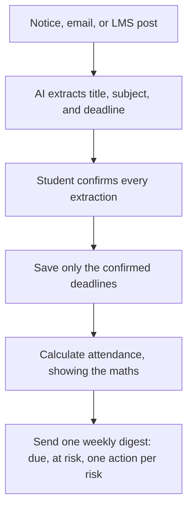
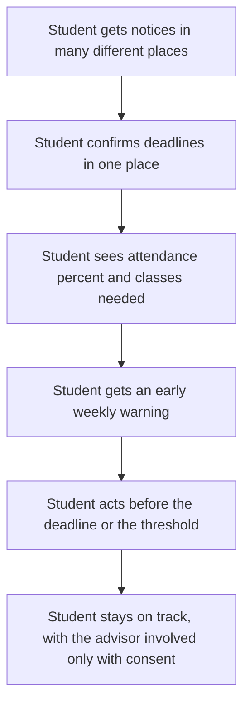
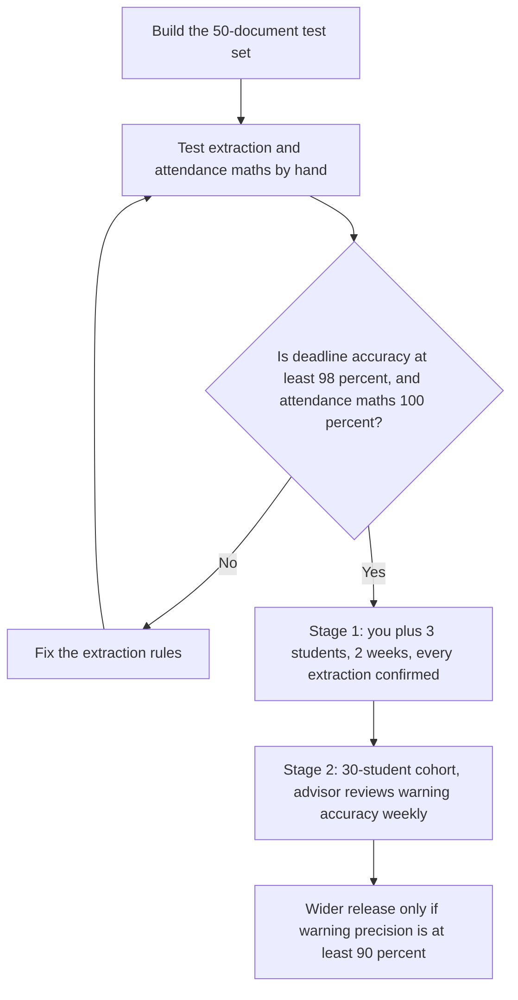

# Diagrams — Student Success Assistant

These are simple diagrams to help a beginner see how the product works. They match the spec in `docs/03-spec.md`. No image files are used — the diagrams below are written in Mermaid text, which GitHub renders as a picture.

## 1. How it works

What this shows: the AI suggests, the student approves. Nothing is saved without confirmation, and every attendance figure shows how it was calculated.

## 2. User journey

What this shows: before the product, a missed notice could mean a missed deadline or an attendance shortfall found too late. After it, the student sees the risk early, while there is still time to act.

## 3. Eval and release flow

What this shows: a wrong deadline is a critical failure, so the product is tested hard first and released in stages. Wider release depends on real warning accuracy, not on a demo.
